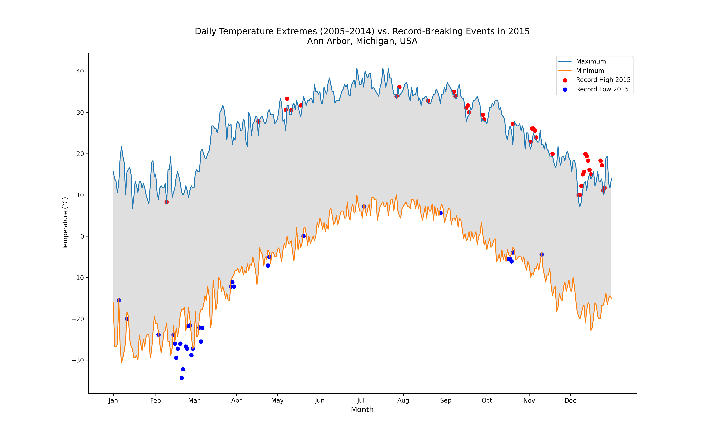

# Visualizing Weather Trends: Ann Arbor, Michigan (2005–2015)



## Overview
This project presents an empirical analysis of daily temperature extremes in the vicinity of **Ann Arbor, Michigan, USA**. Using weather station data spanning 2005 through 2015, the visualization compares the ten-year historical record highs and lows (2005–2014) against record-breaking temperature events observed in 2015.

The objective is to explore patterns of extreme weather phenomena and visually communicate shifts in local climate patterns.

---

## Academic Context & Data Attribution
This project was developed as part of the **Applied Plotting, Charting & Data Representation in Python** course offered by the **University of Michigan** through **Coursera**. 

* **Data Source:** Subset of the *National Centers for Environmental Information (NCEI)* [Global Historical Climatology Network daily (GHCN-Daily)](https://www.ncei.noaa.gov/products/land-based-station/global-historical-climatology-network-daily) dataset.
* **Special Thanks:** University of Michigan & Coursera for providing the dataset and academic framework.

---

## Key Insights
* **Unprecedented Winter Freeze:** February 2015 saw several days where temperatures fell significantly below the 10-year historical record low, dropping past -25 °C due to intense polar vortex conditions.
* **Warm Season Anomaly:** Late autumn and early winter in 2015 recorded notable high-temperature breaks, suggesting unseasonably warm weather patterns during transition months.

---

## Technical Stack & Methods
* **Python 3.8+**
* **Data Processing:** `pandas`, `numpy`, `re` (Regular Expressions for date manipulation and leap year filtering).
* **Visualization:** `matplotlib` (custom axis styling, `fill_between` shading, scatter overlays).

---

## Repository Structure
```text
├── assets/
│   ├── fb441e62df2d58994928907a91895ec62c2c42e6cd075c2700843b89.csv
│   └── temperature_trends.png
├── Climate_Analysis.ipynb
├── README.md
└── requirements.txt
